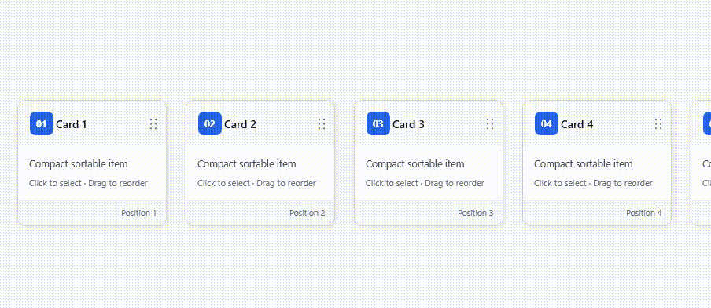
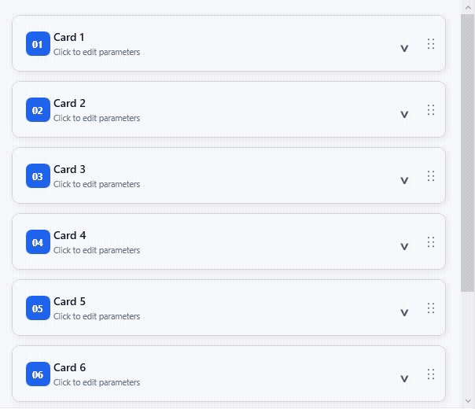

# WPF Sortable Card Layouts Demo

A polished WPF reference implementation for horizontal and vertical sortable card interfaces, including drag previews, animated placeholders, auto-scroll, and expandable parameter panels.

## Preview

The main window presents two independent examples side by side:

- **Horizontal Cards** stay compact and support left-to-right reordering.
- 
- **Vertical Cards** support top-to-bottom reordering and an animated parameter panel.
- 

Before publishing the repository, place the main screenshot or a short drag-and-drop GIF at `docs/preview.gif` and embed it at the top of this section.

## Features

- Horizontal card reordering with a floating drag preview
- Mouse-wheel horizontal scrolling in the horizontal card board
- Vertical card reordering with an insertion placeholder
- Edge-triggered auto-scroll in both orientations
- Smooth card shifting and drop-settle animations
- Expandable vertical parameter panels
- Click-versus-drag threshold handling
- `Esc` to cancel the active drag
- Independent collections for the horizontal and vertical examples
- Reset action that restores order, parameters, selection, and expansion state
- No third-party UI, drag-and-drop, or animation libraries

## Requirements

- Windows 10 or later
- .NET 10 SDK

## How to Run

```powershell
dotnet build
dotnet run
```

## Project Structure

```text
WpfSortableCardLayoutsDemo/
├─ Controls/
│  ├─ HorizontalCardBoard.xaml
│  ├─ HorizontalCardBoard.xaml.cs
│  ├─ VerticalCardBoard.xaml
│  └─ VerticalCardBoard.xaml.cs
├─ Models/
│  └─ CardItemModel.cs
├─ App.xaml
├─ MainWindow.xaml
└─ MainWindow.xaml.cs
```

## Drag-and-Drop Behavior

Each board records the pointer-down position and starts dragging only after the pointer passes the WPF system drag threshold. During a drag, the source card remains in place at low opacity while a floating preview follows the pointer. A placeholder and animated neighboring cards show the pending insertion position.

Moving near a scrollable edge starts auto-scroll. Releasing the pointer settles the preview into the destination slot and then commits the collection move. Pressing `Esc` restores the original order.

## Click-versus-Drag Handling

The vertical card header supports both clicking and dragging:

- A pointer release before crossing the drag threshold toggles the parameter panel.
- Crossing the threshold starts a drag and suppresses the click action.
- Parameter controls live outside the drag header, so editing a field cannot start a drag.

Horizontal cards intentionally never expand. Clicking one only applies a selected visual state.

## No Third-Party Dependencies

The demo uses standard WPF controls, `Canvas`, `ScrollViewer`, `DispatcherTimer`, and built-in animation classes. This keeps the interaction code easy to inspect and reuse.

## Suggested GitHub Topics

`wpf` · `csharp` · `dotnet` · `drag-and-drop` · `sortable` · `card-ui` · `desktop-ui` · `animation` · `code-behind`

## License

MIT. See [LICENSE](LICENSE).
